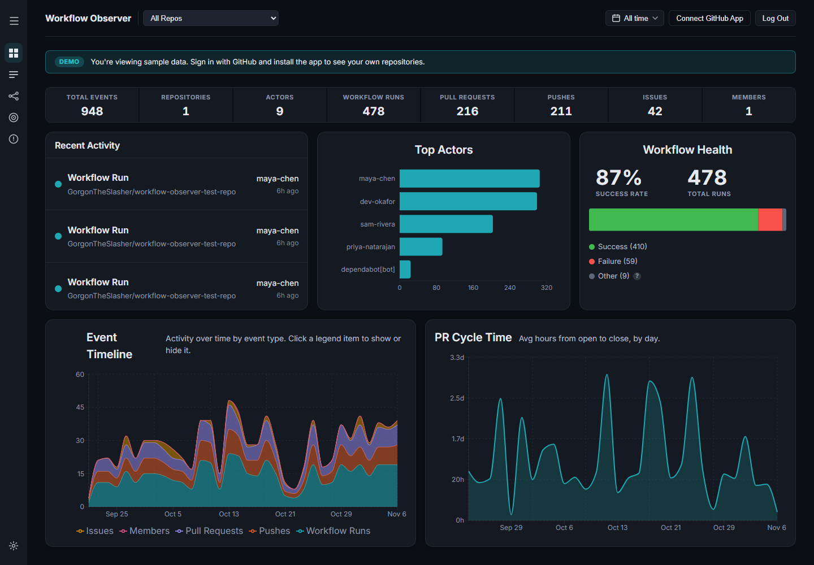
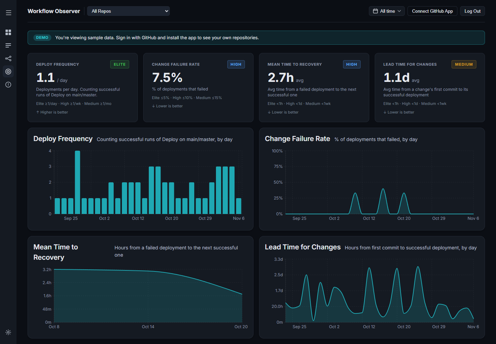
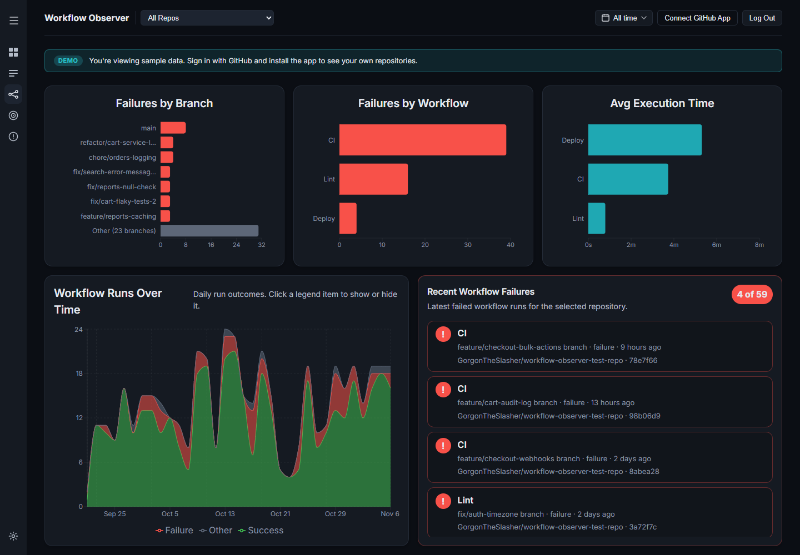
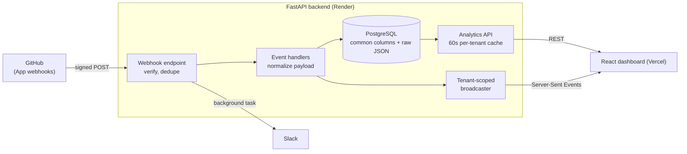

# Workflow Observer

[](https://github.com/GorgonTheSlasher/workflow-observer/actions/workflows/ci.yml)
[](LICENSE)

A GitHub App that turns webhook events into a live dashboard of repository activity, workflow health and DORA metrics, with Slack alerts when something breaks.

**[Try the live demo →](https://workflow-observer.vercel.app)** Click **Try the demo**. No account needed. It runs on sample data, and the free-tier backend sleeps when idle, so the first load can take up to a minute. The page tells you when that's happening.



I built this to learn GitHub's event ecosystem by working with it directly: webhook delivery behavior, GitHub App installation and authorization, and the shape of real event payloads.

## What it does

- **Ingests GitHub webhooks** for pushes, pull requests, issues, workflow runs and repository membership, verifying and deduplicating every delivery.
- **Shows live dashboards** of activity, workflow failures and durations, PR cycle time and issues, filterable by repo and date. Clicking a chart opens the matching events, and any event can be expanded down to its raw payload.
- **Calculates the four DORA metrics** from those events, with the definitions spelled out [below](#how-the-dora-metrics-are-calculated).
- **Sends Slack alerts** for workflow failures, recoveries (with downtime), force pushes to main and new repository members, configurable per rule and per repo.
- **Keeps each installation's data separate,** with a read-only demo tenant for visitors.

| DORA metrics | Workflow runs |
|---|---|
|  |  |

## Architecture



**Stack:** Python, FastAPI, SQLAlchemy, Alembic, PostgreSQL (SQLite locally) · React, TypeScript, Vite, Recharts · pytest, Vitest, Testing Library, Ruff, ESLint · GitHub Actions, Render, Vercel

Each event type has a handler that maps its payload onto a common set of columns (repo, actor, branch, status, conclusion) and keeps the full payload as JSON. Adding an event type means adding one handler rather than changing the schema.

## How webhooks are handled

Most of what I learned is in how GitHub delivers webhooks and what a receiver has to do about it:

| GitHub's behavior | What this app does |
|---|---|
| Anyone can POST to a public webhook URL | Verifies the `X-Hub-Signature-256` HMAC in constant time before parsing the body |
| The same delivery can arrive more than once, for example through a manual redelivery | Stores each `X-GitHub-Delivery` GUID under a unique index. Repeats return 200 and do nothing, including when two copies race each other |
| A delivery fails if the response takes over 10 seconds, and GitHub doesn't retry automatically | Saves the event, responds, and sends Slack alerts afterward in a background task, so a slow Slack can't lose a delivery |
| The `installation_id` on the setup redirect is a plain query parameter anyone can edit | Confirms it against `GET /user/installations` with the user's own token before linking it to their account |

## Design decisions

**Tenant isolation.** Every analytics query filters on the installations the current user can see, and that list is always applied, so an empty list shows nothing rather than everything. The cache key and the live-update stream are scoped the same way. Tests confirm one tenant can't see another's data.

**Tokens stay out of URLs.** URLs end up in logs and browser history, and two parts of the app needed one:
- `EventSource` can't send an `Authorization` header, so the stream opens with a 30-second ticket that works only on that endpoint and is rejected as a login token.
- The GitHub sign-in redirect carries a one-time code that expires in 60 seconds, which the frontend swaps for a token with a POST.

**The webhook URL for alert rules is restricted.** Users supply their own Slack URLs, which would otherwise let them make the server send requests anywhere. Only `https://hooks.slack.com` is accepted, and redirects aren't followed.

**A read-only demo.** "Try the demo" signs visitors into a shared account with no setup. That account can read the demo tenant but can't change settings or send Slack messages. The sample data comes from [a seed script](backend/scripts/seed_demo.py) that simulates a team's work (branches, CI, PRs, deploys, failures and fixes) and sends GitHub-shaped payloads through the real handlers. Links in sample events don't lead to real commits.

**Built for a small server.** The free instance has a fraction of a CPU, so each tab loads only its own data and its code on first open, and aggregates are cached for 60 seconds per tenant. A new webhook clears that tenant's cache, so live updates are never stale.

## How the DORA metrics are calculated

GitHub events don't say what counts as a deployment, so these definitions are choices, and the dashboard shows which workflows it counted.

| Metric | Definition |
|---|---|
| **Deployment** | A run on `main`/`master` of a workflow whose name matches `deploy`, `release`, `publish` or `cd`. A repo with no such workflow falls back to all its runs on those branches, and the dashboard says so |
| **Deploy frequency** | Successful deployments per day |
| **Change failure rate** | Failed deployments ÷ all deployments. A red CI run on a feature branch isn't a failed change |
| **Mean time to recovery** | First failed deployment in a streak to the next success, per repo and workflow, so one repo's success can't close another's incident |
| **Lead time for changes** | A change's first commit to its successful deployment. For a merged PR, that's the first push to its branch since that branch's previous merge |

## Debugging notes

A few problems from building this, and how I worked through them:

**"Failed to fetch" after refreshing a few times, with nothing in the logs.** A 401 looked likely, but a 401 is a readable response and the app would have logged me out, so this was something else. The Network tab showed requests stuck pending and finishing much later. Every page load sent 20+ requests, including for tabs that weren't open, and a refresh doesn't stop work already running on the server, so requests queued up on a very small instance. I couldn't reproduce it on my faster local machine, which pointed at the production CPU limit. Loading only the visible tab and caching aggregates resolved the symptom. I didn't capture the exact response behind the error itself, so that part of the explanation is inferred.

**A login token in the production logs.** While looking into a 401, I noticed the access log contained a working session token, because the live-update connection passed it in the query string. The 401 was harmless, but the logging wasn't, and that led to the stream tickets above.

**Deploy frequency about 3x too high.** Counting every successful run on `main` also counted CI and lint runs as deployments. That's why deployments are now identified by workflow name, per repo.

**The same event showing "just now" and "6h ago".** Timestamps are stored in UTC without a timezone marker. One component parsed them as local time, which put events in the future for anyone west of UTC.

## Running it locally

Requires Python 3.12+ and Node 22. This runs the full dashboard on sample data with no GitHub App needed.

**Backend** (http://localhost:8000, API docs at `/docs`):

```bash
cd backend
python -m venv .venv
source .venv/bin/activate      # Windows: .venv\Scripts\activate
pip install -r requirements.txt

cp .env.example .env           # then set JWT_SECRET; the command is in the file
alembic upgrade head
python scripts/seed_demo.py --installation-id 12345
uvicorn app.main:app --reload
```

**Frontend** (http://localhost:5173):

```bash
cd frontend
npm ci
cp .env.example .env.local
npm run dev
```

Then click **Try the demo**.

**Tests:**

```bash
cd backend && pytest && ruff check .
cd frontend && npm test && npm run lint && npm run build
```

CI runs all of these on every push to `main` and every pull request.

### Connecting a real GitHub App

To receive live events, [register a GitHub App](https://docs.github.com/en/apps/creating-github-apps/registering-a-github-app/registering-a-github-app) and put its credentials in `backend/.env`:

- **Webhook URL:** `https://<your-backend>/webhook/github-app`, with a webhook secret. Locally, use a tunnel such as `smee` or `ngrok`.
- **Callback URL:** `https://<your-backend>/github-app/auth`, with **Request user authorization (OAuth) during installation** enabled.
- **Events:** Push, Pull request, Issues, Member and Workflow run, plus the read permissions GitHub asks for with each.
- Set `GITHUB_APP_SLUG` in `frontend/src/api.ts` to your App's name.

For deployment, run the backend as a **single process**: the live-update broadcaster, the cache and the login codes all live in memory. Run `alembic upgrade head` against the production database before deploying a schema change.

## Known limitations

These are deliberate trade-offs for a project this size, and what I'd change first at real scale:

- **One process only.** Moving the broadcaster, cache and login codes to Redis would allow more than one worker.
- **Aggregates are computed in Python from raw events** on each cache miss. Heavier use would call for pre-computed rollups or more of the work in SQL.
- **Events can be missed while the free-tier host sleeps,** because a cold start takes longer than GitHub's 10-second limit. A paid instance, or a job that redelivers failures through GitHub's API, would close that gap.
- **No rate limiting** on the login and registration endpoints.
- **The login token lives in `localStorage`,** which is simple but readable by any script on the page. An `HttpOnly` cookie would be safer.

## License

[MIT](LICENSE)
